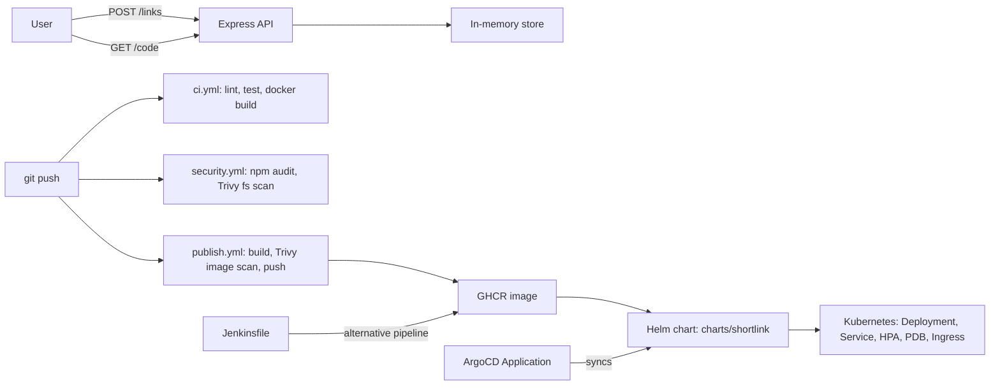

<h1 align="center">🔗 Shortlink Platform</h1>
<p align="center">A URL shortener API with a full CI/CD pipeline: tests, scans, container publishing and Kubernetes packaging</p>

<p align="center">
  
  
  
  
  
  
  
  
  
</p>

---

## 🎯 What it is

`POST /links` turns a long web address into a short code. `GET /:code` redirects to the original address. The service is small on purpose, so the focus is the **delivery pipeline**: every change is tested, scanned, packaged and ready to deploy.

## 📊 Status

| Area | Status | Evidence |
|---|---|---|
| API with validation (only http and https allowed) | ✅ Done | 5 Jest tests in `tests/app.test.js` |
| Multi-stage, non-root Docker image with healthcheck | ✅ Built | `Dockerfile` |
| Hardened Compose (read-only FS, dropped capabilities) | ✅ Written | `docker-compose.yml` |
| CI: lint, test, build | ✅ Done | `ci.yml` workflow |
| Security: npm audit and Trivy filesystem scan | ✅ Done | `security.yml` workflow |
| Publish to GHCR after an image scan | ⏳ Verify in Actions | `publish.yml` workflow |
| Helm chart with HPA, PDB, probes and ingress | ✅ Written | `helm lint` and `helm template` |
| Jenkins pipeline with approval gate | ⏳ Written | Not run on a Jenkins server |
| ArgoCD application | ⏳ Written | Not applied to a cluster |

## 🏗️ Architecture



## 🔁 Pipeline, step by step

1. **Push to `main`.** Three workflows start in parallel: `ci`, `security` and `publish`.
2. **`ci.yml`** installs packages, runs ESLint and Jest on Node 20 and 22, then builds the Docker image.
3. **`security.yml`** runs `npm audit` for production packages and a Trivy scan of the repository.
4. **`publish.yml`** builds the image, scans it with Trivy, and only then logs in and pushes it to GHCR. A vulnerable image never reaches the registry.
5. **Deploy** uses the Helm chart, either through ArgoCD (GitOps) or the Jenkinsfile (approval gate, then `helm upgrade --install`).

## 🧩 Repository structure

```text
shortlink-platform/
├── src/
│   ├── app.js                 routes, validation, redirects, metrics-free store
│   └── server.js              starts the server, handles SIGTERM for clean shutdown
├── tests/app.test.js          5 Jest tests: health, create, redirect, bad input, unknown code
├── Dockerfile                 multi-stage build, non-root user, healthcheck
├── .dockerignore              keeps secrets and junk out of the image
├── docker-compose.yml         local run with a read-only filesystem and resource limits
├── charts/shortlink/          Helm chart: Chart.yaml, values, templates
├── Jenkinsfile                pipeline: lint, test, build, scan, push, approve, deploy
├── deploy/argocd/             ArgoCD Application
├── .github/workflows/         ci.yml, security.yml, publish.yml
└── .github/dependabot.yml     automatic dependency update pull requests

## 📄 File guide

| File | What it does | Connected to |
|---|---|---|
| `src/app.js` | `createApp()` builds the Express app: `/healthz`, `POST /links`, `GET /:code` | Imported by `server.js` and the tests |
| `src/server.js` | Starts listening on `PORT` and stops cleanly on SIGTERM and SIGINT | Starts `app.js` |
| `tests/app.test.js` | Checks the health route, creating and redirecting, rejecting bad URLs and `javascript:` links, and unknown codes | Run by `ci.yml` |
| `Dockerfile` | Stage 1 installs production packages. Stage 2 copies them into a small image and runs as user `node` | `.dockerignore` limits what is copied |
| `.dockerignore` | Excludes `node_modules`, `.git`, `.github`, `.env` and logs | The Dockerfile build |
| `docker-compose.yml` | Runs the image locally with read-only root, `cap_drop: ALL`, `no-new-privileges` and CPU and memory limits | Uses the Dockerfile |
| `charts/shortlink/Chart.yaml` | Chart name and version | Read by Helm |
| `charts/shortlink/values.yaml` | Defaults: 2 replicas, image, resources, autoscaling 2 to 10, PDB | Overridden by `values-prod.yaml` |
| `charts/shortlink/values-prod.yaml` | Production values: 3 replicas, autoscaling 3 to 20, TLS ingress | Used by ArgoCD and Jenkins |
| `charts/shortlink/templates/_helpers.tpl` | Shared names and labels, so Service and Deployment selectors always match | Used by every template |
| `charts/shortlink/templates/deployment.yaml` | Pods with probes on `/healthz`, non-root, read-only filesystem, `/tmp` as an emptyDir | Service, HPA, PDB |
| `charts/shortlink/templates/service.yaml` | Stable address for the pods | Selector from `_helpers.tpl` |
| `charts/shortlink/templates/hpa.yaml` | Scales between min and max replicas on CPU | Targets the Deployment |
| `charts/shortlink/templates/pdb.yaml` | Keeps at least one pod running during maintenance | Pods with the same labels |
| `charts/shortlink/templates/ingress.yaml` | Public host with TLS, only when enabled | Service |
| `Jenkinsfile` | Parallel lint and test, Trivy scan, push, manual approval, Helm deploy with `--atomic` | Pushes the same GHCR image |
| `deploy/argocd/application.yaml` | Tells ArgoCD to keep the cluster in sync with `charts/shortlink` on `main` | Reads the chart |
| `.github/workflows/ci.yml` | Lint, test, build | Runs on every push and pull request |
| `.github/workflows/security.yml` | Weekly and per-push audit and scan | Blocks on high findings |
| `.github/workflows/publish.yml` | Build, scan, then push to GHCR | Needs `packages: write` |

**Languages:** JavaScript (Node.js), YAML (GitHub Actions, Helm, ArgoCD), Go templates (Helm), Groovy (Jenkinsfile), Dockerfile syntax.

## 🚀 Run it locally

```bash
npm ci
npm test
docker build -t shortlink:local .
docker run --rm -p 3000:3000 shortlink:local

curl -X POST http://localhost:3000/links -H "Content-Type: application/json" -d '{"url":"https://example.com"}'
curl -i http://localhost:3000/<code-from-above>
```

## ⚠️ Known gaps

- Links are stored in memory and are lost when the app restarts. A real deployment needs a database.
- Nothing has been run on a Jenkins server or an ArgoCD instance yet.
- No authentication on link creation.

## 🧠 Key decisions

- **Build and scan before publishing:** a failing scan stops the push. See `publish.yml`.
- **Non-root, read-only containers:** a compromised app has less room to cause damage.
- **Helm labels from one helper:** a Service selector can't drift from the Deployment labels.
- **Graceful shutdown:** SIGTERM finishes in-flight requests before the process exits.

## 👤 Author

**Malka Manuranga**, BSc (Hons) Software Engineering, NSBM Green University
[LinkedIn](https://linkedin.com/in/malka-manuranga) · [GitHub](https://github.com/malkamanuranga)
